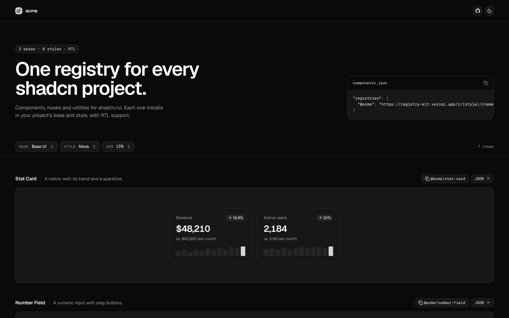

# [registry-kit](https://registry-kit.vercel.app)

A starter for [shadcn registries](https://ui.shadcn.com/docs/registry) that builds every item for every base and style, with RTL, the way shadcn/ui builds its own registry.

Write a component once per base. Projects install the version that matches the base and style in their `components.json`.

[Live preview](https://registry-kit.vercel.app) · [Documentation](#documentation) · [Contributing](./CONTRIBUTING.md)

[](https://registry-kit.vercel.app)

## Features

- **3 bases:** Base UI, Radix UI and React Aria
- **8 styles:** Vega, Nova, Maia, Lyra, Mira, Luma, Sera and Rhea, matching shadcn/ui's
- **RTL:** logical classes in the source, which the shadcn CLI converts on install
- **Fallbacks:** projects on a style you don't build get your Nova build, not a 404
- **Build checks:** missing dependencies, unstyled markers and bases that drift apart fail the build
- **Preview site:** every item in every base, style and direction
- **Setup CLI:** keep only the bases, styles and items you need

## Quick start

Click **Use this template** on GitHub, then:

```bash
git clone https://github.com/<you>/<your-registry>
cd <your-registry>
pnpm install
pnpm registry:init
pnpm dev
```

`registry:init` asks for your registry's name, homepage and repository, and which bases, styles and example items to keep. Open <http://localhost:3002> to see the preview.

See [Setup](./docs/setup.md) for the flags and for deploying.

## Installing items

A project adds your registry once:

```bash
pnpm dlx shadcn@latest registry add "@acme=https://acme.com/r/{style}/{name}.json"
```

Then installs items by name:

```bash
pnpm dlx shadcn@latest add @acme/stat-card
```

The CLI fills `{style}` from the project's `components.json`, like `base-nova`, so each project gets the build for its own base and style.

## Documentation

- [Setup](./docs/setup.md): run `registry:init`, then deploy
- [Adding items](./docs/adding-items.md): write an item, style it and pass the build checks
- [How it works](./docs/how-it-works.md): the build, the install, fallbacks and the preview

## Scripts

| Command               | What it does                                                          |
| --------------------- | --------------------------------------------------------------------- |
| `pnpm registry:init`  | Choose the registry's name, bases, styles and items                   |
| `pnpm dev`            | Start the preview on port 3002                                        |
| `pnpm build`          | Build the registry, then the site                                     |
| `pnpm registry:build` | Build `public/r` for every base and style                             |
| `pnpm registry:test`  | Install every item for every base, style and `components.json` option |
| `pnpm registry:sync`  | Sync shadcn/ui primitives and styles from `SHADCN_REF`                |
| `pnpm test`           | Test `registry:init` on a copy of the registry                        |
| `pnpm check`          | Lint, check formatting and type-check                                 |

Requires Node 24.2 or later and pnpm. The scripts run on Node's built-in TypeScript support.

## Contributing

Read the [contributing guide](./CONTRIBUTING.md).

## License

[MIT](./LICENSE)
